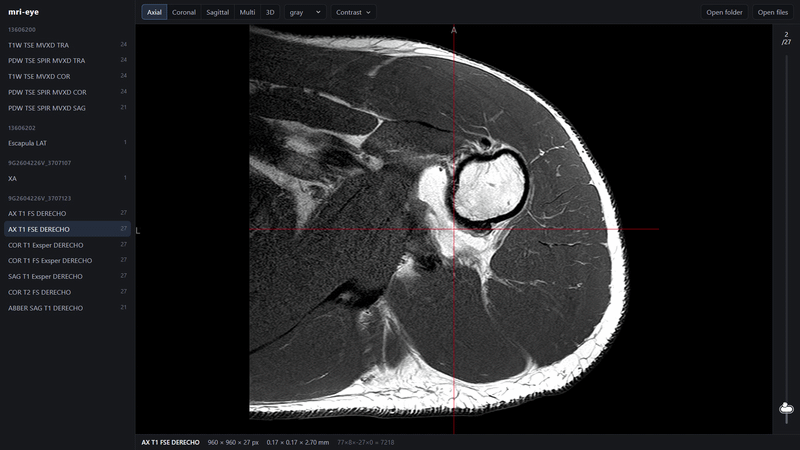

# mri-eye

A simple, fast MRI viewer that runs in your browser. Open a hospital CD export (DICOM), NIfTI files or plain X-ray pictures (PNG/JPEG), pick a series and scroll through it. Everything stays on your machine. Nothing is uploaded.



Stack: Vite + Svelte 5 + TypeScript (pnpm), with [NiiVue](https://github.com/niivue/niivue) (WebGL2) for rendering. DICOM is converted in the browser by [dcm2niix](https://github.com/rordenlab/dcm2niix) running as WebAssembly.

## Run

```bash
pnpm install
pnpm dev
```

Studies in `footage/` show up in the sidebar automatically, in collapsible groups (one per top-level folder, collapsed until you click them). You can also use **Open folder** / **Open files**, or drag a DICOM folder, `.nii` / `.nii.gz` file or picture (`.png`, `.jpg`, …) onto the viewer. Colour pictures are shown in grayscale so the contrast controls work on them.

## Adding a CD

Hospital CDs (and Idonia downloads) ship many extra files (bundled Windows/Mac viewers, dose reports) around the images. Import one so only the images are kept, sorted into a group and an exam:

```
footage/<group>/<exam>/<NN_SeriesDescription>/*.dcm      e.g. footage/2026-08-26 (MR Arthro)/MR arthrography/01_AX_T1_FS_DERECHO/
```

```bash
node scripts/import-cd.mjs "D:/"                          # copy a CD in; named from the scans, e.g. 2026-04-15/MRI
node scripts/import-cd.mjs footage/SOME_EXPORT --move      # sort an export already copied into footage/, then remove it
node scripts/import-cd.mjs footage/SOME_EXPORT --move --name "2026-08-26 (MR Arthro)/MR arthrography"   # choose the names yourself
```

By default the group is the study date and the exam is derived from the modality (MR → MRI, DX/CR → XRAY, XA/RF → Fluoroscopy, CT, US → Ultrasound). Use `--name "<group>/<exam>"` for anything else, like an arthrography. Groups can also be renamed by hand at any time; they're sorted alphabetically, so starting them with the date keeps them in time order.

## Controls

| | |
|---|---|
| Sidebar | click a group to expand / collapse it, click a series to open it |
| Scroll wheel / slice bar (right edge) | next / previous slice |
| Left click / drag | move crosshair |
| Toolbar → Contrast | brightness / contrast sliders, reset |
| Toolbar | Axial · Coronal · Sagittal · Multi · 3D, colormap |
| 3D view | left drag rotates; scroll wheel zooms (or moves the cut once one is set) |
| 3D: right bar + Cut from Front · Side · Top | cut into the volume to see inside; Lighting adds shading |

A series opens in the plane it was acquired in. Oblique shoulder or knee planes snap to the nearest standard view, so a "COR oblique" series may open as Sagittal.

## Privacy

`footage/` is gitignored because DICOM headers (and the folder names of raw CD exports) contain patient identifiers. Never commit scans. The `/api/studies` and `/footage/*` endpoints exist only on the local dev server and are not part of `pnpm build`.

## Scripts

- `pnpm dev`: dev server with the footage browser
- `pnpm build`: static build (open/drop only; no footage listing)
- `pnpm check`: svelte-check + TypeScript
